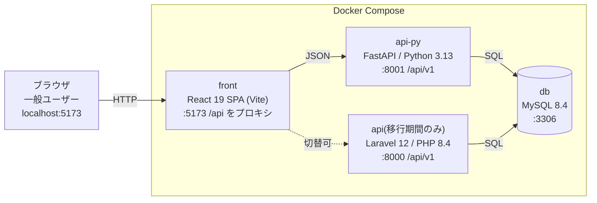
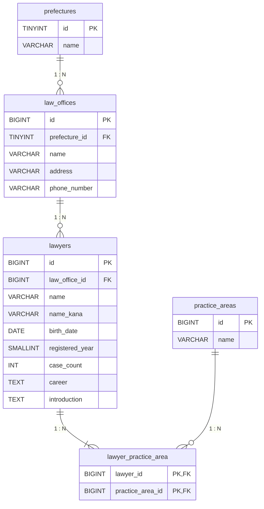

# 弁護士検索システム 要件定義書(FastAPI版)

2026-11-20

## 0. この文書の位置付け

Laravel 版(要件定義書 [ben54-labo.md](ben54-labo.md))のバックエンドを、Python の FastAPI で作り直すための要件定義書。`backend-python/` 配下の作業は、この文書を唯一の正とする。

| 項目 | 方針 |
| --- | --- |
| 作り直す範囲 | バックエンド(`backend/` → `backend-python/`)のみ |
| フロントエンド | 変更しない。API の URL・JSON の形・ステータスコード・エラーメッセージを Laravel 版と同じにする(API 互換) |
| Laravel 版 | 移行が終わるまで `backend/` と `ben54-labo.md`、`docs/01〜16` をそのまま残す。CI も両方を実行する |
| 機能・画面・API・DB | Laravel 版と同じ(3〜6章)。違うのは実装の技術と、その書き方(7・8章) |
| チケット | `docs/python/` 配下の連番チケットに分ける(一覧は [docs/python/README.md](docs/python/README.md)) |

## 1. 概要

一般ユーザーが都道府県・取扱分野・キーワードで弁護士を検索し、一覧のソートと詳細の閲覧ができるSPA。ポートフォリオとして、API設計、DB設計、テストの品質を示すことを目的とする。

| 項目 | 内容 |
| --- | --- |
| 開発目的 | ポートフォリオ(学習作品) |
| 利用者 | 一般ユーザーのみ(ログイン不要) |
| 開発体制 | 個人開発 |
| 構成 | FastAPI(REST API)+ React 19(SPA)+ MySQL 8.4 |
| 起動方法 | `docker compose up -d --wait` で db / api / api-py / front の4コンテナを一括起動 |

### システム構成図



ブラウザはfrontにだけ接続し、`/api` へのリクエストはViteのプロキシ経由でAPIに届く。転送先は環境変数 `API_PROXY_TARGET` で切り替える(初期値は Laravel 版の `http://api:8000`。FastAPI 版は `http://api-py:8001`)。

DB はコンテナを共有するが、データベースは Laravel 版と分ける(マイグレーションの管理方法が違うため)。

| 用途 | Laravel 版 | FastAPI 版 |
| --- | --- | --- |
| 開発用 | `lawyer_search` | `lawyer_search_py` |
| テスト用 | `lawyer_search_test` | `lawyer_search_py_test` |
| DBユーザー | `laravel` | `fastapi` |

## 2. スコープ

MVPは「検索 → 一覧(ソート・ページネーション)→ 詳細」の閲覧機能に絞り、データの更新機能は持たない。

| 区分 | 項目 |
| --- | --- |
| 対象 | 都道府県・取扱分野(複数選択・OR)・キーワードによる検索 |
| 対象 | 名前・年齢・取扱裁判実績数によるソート |
| 対象 | 1ページあたり20件のページネーション |
| 対象 | 弁護士の詳細を返すAPI |
| 対象 | Seederによるダミーデータ1,000件の投入 |
| 対象 | pytestによる正常系・異常系のテスト |
| 対象 | docker-composeによるローカル開発環境 |
| 対象外 | フロントエンドの変更(API互換を保つため、原則として触らない) |
| 対象外 | Laravel 版のデータの移し替え(どちらもSeederで作り直せる) |
| 対象外 | 会員登録・ログインなどの認証機能 |
| 対象外 | 管理画面、弁護士本人による登録・編集 |
| 対象外 | 顔写真・画像のアップロード |
| 対象外 | お気に入り、問い合わせ、口コミ、地図表示 |
| 対象外 | 市区町村・最寄り駅など、都道府県より細かい地域検索 |
| 対象外 | 本番環境(AWSなど)へのデプロイ |
| 対象外 | 非同期DBドライバ(asyncio)の採用。同期の SQLAlchemy を使う(8.1節の理由を参照) |

## 3. 機能要件

Laravel 版と同じ。検索条件は3種類で、条件同士はAND、取扱分野の複数選択だけはORで結合する。一覧は取扱裁判実績数の多い順を初期表示とする。

### 3.1 検索

| ID | 機能 | 仕様 |
| --- | --- | --- |
| F-01 | 都道府県で絞り込む | 47都道府県から1つ選ぶ(単一選択)。未選択なら全国が対象。弁護士の都道府県は所属事務所の所在地で判定する |
| F-02 | 取扱分野で絞り込む | 複数選択できる。選んだ分野のいずれか1つでも扱う弁護士を返す(OR条件)。結果に同じ弁護士を重複させない |
| F-03 | キーワードで検索する | 名前・フリガナ・事務所名・自己紹介を部分一致で検索する。空白(半角・全角)で区切った複数語はAND。最大100文字 |
| F-04 | 条件を組み合わせる | F-01〜F-03はANDで結合する。全条件が未入力なら全件を返す |

F-05(URLに条件を保持)、F-06(クリア)はフロントの機能のため、FastAPI 版では変わらない。

### 3.2 一覧・ソート・ページネーション

| ID | 機能 | 仕様 |
| --- | --- | --- |
| F-07 | 検索結果を一覧で返す | 名前、年齢、事務所名、都道府県、取扱分野、取扱裁判実績数を返す。総件数も返す |
| F-08 | 取扱裁判実績数でソートする | 全分野合計の実績数が多い順。初期値のソート |
| F-09 | 年齢でソートする | 年齢が高い順(生年月日の古い順)。日単位で並べる |
| F-10 | 名前でソートする | フリガナの五十音順(あ→ん) |
| F-11 | 並び順を安定させる | ソートキーが同じ値のときはIDの昇順で並べ、ページをまたいで重複や欠落が起きないようにする |
| F-12 | ページを切り替える | 1ページあたり20件 |

### 3.3 詳細

| ID | 機能 | 仕様 |
| --- | --- | --- |
| F-14 | 弁護士の詳細を返す | 名前、フリガナ、生年月日、年齢(生年月日から算出)、弁護士登録年、所属事務所、事務所住所、電話番号、取扱分野、取扱裁判実績数、経歴、自己紹介 |
| F-16 | 存在しないIDへの対応 | 404を返す |

### 3.4 共通

| ID | 機能 | 仕様 |
| --- | --- | --- |
| F-18 | エラーを返す | 入力エラーは422、サーバーエラーは500。フロントが項目の近くや画面上部に表示できる形にする(5.4節) |
| F-19 | マスターを返す | 都道府県と取扱分野の選択肢をAPIで返す |

取扱分野の初期マスターは12分野とする:離婚・男女問題、相続、交通事故、債務整理、刑事事件、労働問題、企業法務、不動産・建築、医療問題、消費者被害、知的財産、外国人問題。

## 4. 画面一覧

画面はフロントエンドのため Laravel 版(ben54-labo.md 4章)と同じで、変更しない。FastAPI 版に切り替えたあとも、SCR-01〜03 がすべて同じように動くことを確認する。

## 5. API一覧

Laravel 版と同じ。APIは参照系の4本で、すべて認証不要のGET。ベースURLは `http://localhost:8001/api/v1`(フロントからは Vite のプロキシ経由で `/api/v1`)、形式はJSON(UTF-8)。

| ID | メソッド | パス | 概要 | 正常 | 異常 |
| --- | --- | --- | --- | --- | --- |
| API-01 | GET | `/lawyers` | 弁護士を検索し、ページ単位で返す | 200 | 422, 500 |
| API-02 | GET | `/lawyers/{id}` | 弁護士1件の詳細を返す | 200 | 404, 500 |
| API-03 | GET | `/prefectures` | 都道府県47件を返す | 200 | 500 |
| API-04 | GET | `/practice-areas` | 取扱分野の一覧を返す | 200 | 500 |

コンテナのヘルスチェック用に `GET /up`(`/api/v1` の外)を用意し、`{ "status": "ok" }` を返す。

### 5.1 API-01 のリクエストパラメータ

| パラメータ | 型 | 必須 | 検証内容 | 初期値 |
| --- | --- | --- | --- | --- |
| `prefecture_id` | integer | 任意 | 整数であること。prefectures に存在すること | なし(全国) |
| `practice_area_ids[]` | integerの配列 | 任意 | 12個以下。要素は整数で、重複せず、practice_areas に存在すること | なし |
| `keyword` | string | 任意 | 100文字以下 | なし |
| `sort` | string | 任意 | `case_count` / `age` / `name` のいずれか | `case_count` |
| `page` | integer | 任意 | 整数で、1以上 | 1 |

- 配列はフロント(axios)の形式に合わせ、`practice_area_ids[]=1&practice_area_ids[]=2` で受け取る。`practice_area_ids=1`(`[]` なし)で1つだけ送られた場合は「配列でない」として422にする(Laravel 版と同じ)
- 検証は `SearchLawyerRequest`(Pydantic モデル + 依存関数)で行う。「存在すること」はDBを見るため、型の検証のあとに依存関数の中で確認する
- 空文字のパラメータ(`?keyword=`)は「未指定」として扱う(Laravel の `ConvertEmptyStringsToNull` と同じ)
- 最終ページを超える `page` はエラーにせず、空の `data` を200で返す

| `sort` | 並び順(SQL) |
| --- | --- |
| `case_count` | `case_count DESC, id ASC` |
| `age` | `birth_date ASC, id ASC` |
| `name` | `name_kana ASC, id ASC` |

### 5.2 API-01 のレスポンス(200)

```json
{
  "data": [
    {
      "id": 128,
      "name": "山田 太郎",
      "name_kana": "ヤマダ タロウ",
      "age": 52,
      "case_count": 340,
      "law_office": { "id": 12, "name": "山田総合法律事務所" },
      "prefecture": { "id": 13, "name": "東京都" },
      "practice_areas": [
        { "id": 1, "name": "離婚・男女問題" },
        { "id": 2, "name": "相続" }
      ]
    }
  ],
  "links": { "first": "...?page=1", "last": "...?page=50", "prev": null, "next": "...?page=2" },
  "meta": { "current_page": 1, "last_page": 50, "per_page": 20, "total": 1000, "from": 1, "to": 20 }
}
```

- `links` はリクエストの他のクエリ(検索条件・ソート)を残した絶対URLにする(Laravel の `withQueryString()` と同じ)
- 0件のときは `last_page` を1、`from` と `to` を `null` にする。最終ページを超えたときも `from` と `to` は `null`
- 各弁護士の `practice_areas` は `id` の昇順

### 5.3 API-02 のレスポンス(200)

```json
{
  "data": {
    "id": 128,
    "name": "山田 太郎",
    "name_kana": "ヤマダ タロウ",
    "birth_date": "1974-04-12",
    "age": 52,
    "registered_year": 2001,
    "case_count": 340,
    "career": "2001年 弁護士登録 ...",
    "introduction": "相続と離婚を中心に ...",
    "law_office": {
      "id": 12,
      "name": "山田総合法律事務所",
      "address": "東京都千代田区 ...",
      "phone_number": "03-1234-5678"
    },
    "prefecture": { "id": 13, "name": "東京都" },
    "practice_areas": [ { "id": 1, "name": "離婚・男女問題" } ]
  }
}
```

`{id}` は1以上の整数だけを受け付ける。数値でないID(`abc`)や `0` は、Laravel 版と同じく422ではなく404にする。

API-03とAPI-04は `{ "data": [ { "id": 1, "name": "北海道" } ] }` の形で、`id` の昇順に返す。

### 5.4 エラーレスポンス

| ステータス | 発生条件 | ボディ |
| --- | --- | --- |
| 404 | 存在しないID、数値でないID、`/api` 配下の未定義のパス | `{ "message": "弁護士が見つかりません。" }` |
| 405 | 許可されていないメソッド(`POST /api/v1/lawyers` など) | `{ "message": "Method Not Allowed" }` |
| 422 | 検証エラー | `{ "message": "...", "errors": { "keyword": ["キーワードは100文字以内で入力してください。"] } }` |
| 429 | レート制限超過(1IPあたり毎分60回) | `{ "message": "Too Many Attempts." }` |
| 500 | 予期しない例外 | `{ "message": "サーバーエラーが発生しました。" }`(スタックトレースは返さない) |

FastAPI の初期値(`{ "detail": ... }`)は使わず、すべて上の形に変換する。

#### 422 の形

- `errors` のキーはパラメータ名。配列の要素は `practice_area_ids.0` のように添字を付ける
- `message` は最初のエラー文。エラーが2件以上あるときは末尾に ` (他N件のエラー)` を付ける(例:`都道府県は整数で指定してください。 (他3件のエラー)`)
- 1つの項目につき、最初に見つかったエラーだけを返す(Laravel の `bail` と同じ)

#### 422 のエラー文

項目名は 都道府県 / 取扱分野 / キーワード / 並び順 / ページ とする。

| 対象 | 条件 | エラー文 |
| --- | --- | --- |
| `prefecture_id` | 整数でない | 都道府県は整数で指定してください。 |
| `prefecture_id` | 存在しない | 選択された都道府県は正しくありません。 |
| `practice_area_ids` | 配列でない | 取扱分野は配列で指定してください。 |
| `practice_area_ids` | 13個以上 | 取扱分野は12個以下で指定してください。 |
| `practice_area_ids.N` | 整数でない | 取扱分野は整数で指定してください。 |
| `practice_area_ids.N` | 重複している | 取扱分野に重複した値があります。 |
| `practice_area_ids.N` | 存在しない | 選択された取扱分野は正しくありません。 |
| `keyword` | 101文字以上 | キーワードは100文字以内で入力してください。 |
| `sort` | 定義外 | 選択された並び順は正しくありません。 |
| `page` | 整数でない | ページは整数で指定してください。 |
| `page` | 0以下 | ページは1以上の値を指定してください。 |

エラー文は `app/core/messages.py` にまとめ、コードに直書きしない。

## 6. ER図・テーブル定義

Laravel 版と同じ。テーブルは5つ。事務所を弁護士から切り出して正規化し、弁護士と取扱分野の多対多は中間テーブルで表す。弁護士の都道府県は事務所経由で決まる。



テーブルは SQLAlchemy のモデルで定義し、Alembic のマイグレーションで作る。created_at / updated_at は図では省略した。

### 6.1 prefectures(都道府県マスター)

| カラム | 型 | NULL | キー | 説明 |
| --- | --- | --- | --- | --- |
| id | TINYINT UNSIGNED | 不可 | PK | JISの都道府県コード(1〜47)。自動採番しない |
| name | VARCHAR(10) | 不可 | UNIQUE | 都道府県名 |
| created_at / updated_at | TIMESTAMP | 可 | | |

### 6.2 practice_areas(取扱分野マスター)

| カラム | 型 | NULL | キー | 説明 |
| --- | --- | --- | --- | --- |
| id | BIGINT UNSIGNED | 不可 | PK | |
| name | VARCHAR(50) | 不可 | UNIQUE | 分野名 |
| created_at / updated_at | TIMESTAMP | 可 | | |

### 6.3 law_offices(法律事務所)

| カラム | 型 | NULL | キー | 説明 |
| --- | --- | --- | --- | --- |
| id | BIGINT UNSIGNED | 不可 | PK | |
| prefecture_id | TINYINT UNSIGNED | 不可 | FK, INDEX | prefectures.id |
| name | VARCHAR(100) | 不可 | | 事務所名(キーワード検索の対象) |
| address | VARCHAR(255) | 不可 | | 住所(都道府県から) |
| phone_number | VARCHAR(20) | 不可 | | ハイフン付き |
| created_at / updated_at | TIMESTAMP | 可 | | |

### 6.4 lawyers(弁護士)

| カラム | 型 | NULL | キー | 説明 |
| --- | --- | --- | --- | --- |
| id | BIGINT UNSIGNED | 不可 | PK | |
| law_office_id | BIGINT UNSIGNED | 不可 | FK, INDEX | law_offices.id |
| name | VARCHAR(50) | 不可 | | 氏名(姓と名の間に半角スペース) |
| name_kana | VARCHAR(100) | 不可 | INDEX | フリガナ(全角カタカナ)。名前順ソートに使う |
| birth_date | DATE | 不可 | INDEX | 生年月日。年齢は保存せず、取得時に算出する |
| registered_year | SMALLINT UNSIGNED | 不可 | | 弁護士登録年 |
| case_count | INT UNSIGNED | 不可 | INDEX | 取扱裁判実績数(全分野の合計)。初期値0 |
| career | TEXT | 不可 | | 経歴 |
| introduction | TEXT | 不可 | | 自己紹介(キーワード検索の対象) |
| created_at / updated_at | TIMESTAMP | 可 | | |

### 6.5 lawyer_practice_area(弁護士×取扱分野の中間テーブル)

| カラム | 型 | NULL | キー | 説明 |
| --- | --- | --- | --- | --- |
| lawyer_id | BIGINT UNSIGNED | 不可 | PK(1番目), FK | lawyers.id(弁護士削除時に CASCADE) |
| practice_area_id | BIGINT UNSIGNED | 不可 | PK(2番目), FK, INDEX | practice_areas.id |

複合主キー (lawyer_id, practice_area_id) で重複登録を防ぐ。分野での絞り込み用に (practice_area_id, lawyer_id) のインデックスを別に張る。

### 6.6 検索クエリの方針

- 分野のOR条件はJOINではなく `Lawyer.practice_areas.any(PracticeArea.id.in_(ids))`(EXISTSサブクエリ)で書き、結果の重複を防ぐ。都道府県も `Lawyer.law_office.has(...)` で書く
- 一覧の関連データは `selectinload(Lawyer.law_office).selectinload(LawOffice.prefecture)` と `selectinload(Lawyer.practice_areas)` で事前に読み込み、N+1問題を防ぐ。リレーションは `lazy="raise"` にし、読み込み忘れをテストで検出する
- 総件数は、絞り込み条件だけを付けた `SELECT COUNT(*)` を別に発行する
- キーワードの `LIKE '%語%'` はインデックスが効かない。ただし1,000件では問題にならないため採用する
- `LIKE` に渡す前に `\`、`%`、`_` をエスケープする(`escape_like`)。SQLAlchemy の `like(..., escape="\\")` でエスケープ文字を明示する

### 6.7 ダミーデータ(Seeder)

| テーブル | 件数 | 生成ルール |
| --- | --- | --- |
| prefectures | 47 | 固定値(`app/data/prefectures.py`) |
| practice_areas | 12 | 固定値(`app/data/practice_areas.py`) |
| law_offices | 300 | Faker(ja_JP)。都道府県は人口に応じて偏らせ、東京・大阪・愛知などを多くする(`app/data/prefecture_profiles.py`) |
| lawyers | 1,000 | 25〜80歳。登録年は25歳以降の年。実績数は0〜500。氏名とフリガナは `app/data/names.py` から組み合わせる |
| lawyer_practice_area | 約2,500 | 1人あたり1〜4分野をランダムに割り当てる |

Faker と `random` のシード値を固定し、何度投入しても同じデータになるようにする(PHP と Python で乱数が違うため、Laravel 版と同じデータにはならない)。実行は `docker compose exec api-py uv run python -m app.seeders --fresh`(テーブルを作り直してから投入する)。

## 7. 非機能要件

### 7.1 技術スタック

| 区分 | 採用技術 | バージョン |
| --- | --- | --- |
| 言語 | Python | 3.13 |
| Webフレームワーク | FastAPI + Uvicorn | 0.165 / 0.54 |
| ORM | SQLAlchemy(同期)+ PyMySQL | 2.1 / 1.2 |
| マイグレーション | Alembic | 1.20 |
| 検証・設定 | Pydantic + pydantic-settings | 2.14 / 2.16 |
| レート制限 | slowapi | 0.1.10 |
| パッケージ管理 | uv(`pyproject.toml` + `uv.lock`) | 0.8.4 |
| テスト | pytest + pytest-cov + httpx(TestClient)+ factory_boy + time-machine | 9.2 / 7.1 / 0.28 / 3.3 / 3.6 |
| コード整形・静的解析 | Ruff(lint と整形)、mypy(`strict`) | 0.17 / 2.4 |
| DB | MySQL(utf8mb4 / utf8mb4_0900_ai_ci) | 8.4 |
| フロントエンド | Laravel 版と同じ(React 19 / TypeScript / Vite) | |

正確なバージョンは `uv.lock` で固定する。

### 7.2 コンテナ構成

| サービス | イメージ | ポート | 役割 |
| --- | --- | --- | --- |
| db | mysql:8.4 | 3306 | Laravel 版と FastAPI 版の両方のDBを持つ。`docker/mysql/init/` で初回起動時に作る |
| api | php:8.4 | 8000 | Laravel 版。移行が終わるまで残す |
| api-py | python:3.13-slim + uv(`docker/python/Dockerfile`) | 8001 | FastAPI 版。起動時に `uv sync` してから `uvicorn --reload` で起動する。仮想環境は名前付きボリューム(`/opt/venv`)に置く |
| front | node:22 | 5173 | Viteの開発サーバー。`/api` へのリクエストを `API_PROXY_TARGET` に転送する |

`docker compose up -d --wait` のあと `docker compose exec api-py uv run python -m app.seeders --fresh` を実行すれば、FastAPI 版のデータが入った状態になる。手順は `backend-python/README.md` に書く。

### 7.3 性能

| 項目 | 目標値 |
| --- | --- |
| API-01(検索)の応答時間 | 1,000件・全条件指定で500ms以内 |
| API-02〜04の応答時間 | 200ms以内 |
| 1リクエストあたりのSQL発行数 | 件数によらず一定(N+1を出さない) |

### 7.4 セキュリティ

- SQLインジェクション:SQLAlchemy の式とバインド変数だけを使い、`text()` に入力値を連結しない
- CORS:許可するオリジンは `FRONTEND_URL`(`http://localhost:5173`)のみ。メソッドは GET のみ
- レート制限:`/api/v1` 配下の全体で1IPあたり毎分60回(slowapi)
- 入力検証:すべてのパラメータを `SearchLawyerRequest` で検証する
- 情報漏えい:`APP_DEBUG` の値によらず、500エラーでスタックトレースを返さない。OpenAPI の画面(`/docs`)は `APP_DEBUG=true` のときだけ公開する。`.env` はリポジトリに含めず `.env.example` を置く

### 7.5 保守性

バックエンドの責務を Laravel 版と同じ考え方で分ける。

| 責務 | Laravel 版 | FastAPI 版 |
| --- | --- | --- |
| 入出力 | Controller | `app/routers/`(APIRouter。処理を書かず、Service を呼んで Schema に詰めるだけ) |
| 入力検証 | FormRequest(`SearchLawyerRequest`) | `app/schemas/search_lawyer_request.py`(`SearchLawyerRequest` と依存関数) |
| 検索ロジック | Service(`LawyerSearchService`) | `app/services/lawyer_search_service.py`(`LawyerSearchService`) |
| 絞り込み条件 | Model のスコープ | `Lawyer` のクラスメソッド `in_prefecture` / `with_any_practice_area` / `match_keyword`(`Select` を受け取り、条件を足した `Select` を返す) |
| 年齢 | `age` アクセサ | `Lawyer.age`(`@property`) |
| 出力の整形 | API Resource | `app/schemas/`(Pydantic の出力モデル。`from_attributes=True`) |
| ソート種別 | Enum `LawyerSortType` | `app/enums/lawyer_sort_type.py`(`StrEnum`。`order_columns()` を持つ) |
| LIKE のエスケープ | `LikeEscaper::escapeLike` | `app/support/like_escaper.py`(`escape_like`) |
| DB接続 | Eloquent | `app/core/database.py`(`get_session` を依存関数として渡す) |
| 例外の変換 | `bootstrap/app.php` | `app/core/errors.py`(例外ハンドラ) |

- すべての関数の引数と戻り値に型ヒントを書き、mypy の `strict` で検査する(Laravel 版の `declare(strict_types=1);` に当たる)
- 整形と lint は Ruff で行う(行の長さは100)
- ソート種別などの定数は Enum や定数に置き、文字列を直書きしない

### 7.6 対応環境・ログ

| 項目 | 内容 |
| --- | --- |
| 可用性・バックアップ | ローカル開発のみのため定めない。データはSeederで再生成できる |
| ログ | 標準の `logging` で標準出力に出す(`docker compose logs api-py` で見る)。500エラー時は例外とスタックトレースを記録する |

## 8. テスト方針

バックエンドのすべての公開関数・メソッドとAPIについて、正常系と異常系をpytestでテストする。合格基準は「全テスト成功」と「`app/` の行カバレッジ80%以上」。

### 8.1 実施方法

| 項目 | 内容 |
| --- | --- |
| ツール | pytest(`uv run pytest`) |
| テスト用DB | dbコンテナ内のMySQL `lawyer_search_py_test`(本番と同じMySQLで確認するためSQLiteは使わない) |
| テーブルの用意 | テストの開始時に1回だけ、全テーブルを消して Alembic で作り直す(マイグレーションもテストされる) |
| データの初期化 | テストごとにトランザクションを開始し、終わったらロールバックする(Laravel の `RefreshDatabase` に当たる) |
| テストデータ | factory_boy の Factory でテストごとに必要な件数だけ作る(Seederの1,000件には依存しない) |
| 日付 | 年齢のテストは time-machine(`time_machine.travel`)で現在日時を固定する |
| APIのテスト | FastAPI の `TestClient`。`get_session` をテスト用のセッションに差し替える |
| 実行コマンド | `docker compose exec api-py uv run pytest --cov` |
| テスト名 | `test_対象_条件_期待結果` の形で書く(例:`test_search_存在しない都道府県ID_422を返す`) |

同期の SQLAlchemy を使うのは、テストのトランザクション管理を単純にし、Laravel 版と同じ考え方(1リクエスト1セッション)で書くため。FastAPI は同期の関数をスレッドプールで実行するので、この規模では性能に問題はない。

### 8.2 Featureテスト(API単位)

`tests/feature/` に置く。

| 対象 | 区分 | テストケース | 期待結果 |
| --- | --- | --- | --- |
| API-01 | 正常 | 条件なしで検索する | 200。`data` が20件、`meta.total` が全件数 |
| API-01 | 正常 | 都道府県を指定する | その県の事務所に所属する弁護士だけを返す |
| API-01 | 正常 | 分野を2つ指定する | どちらかを扱う弁護士を返し、両方を扱う弁護士が重複しない |
| API-01 | 正常 | キーワードで検索する | 名前・フリガナ・事務所名・自己紹介のどれかに含む弁護士をそれぞれ返す |
| API-01 | 正常 | 空白区切りの2語で検索する | 両方を含む弁護士だけを返す |
| API-01 | 正常 | 3条件をすべて指定する | すべてを満たす弁護士だけを返す(AND) |
| API-01 | 正常 | `sort` を省略 / `case_count` / `age` / `name` | それぞれ5.1節の順に並ぶ。同値はID昇順 |
| API-01 | 正常 | 2ページ目を指定する | 21件目から返し、1ページ目と重複しない |
| API-01 | 正常 | 最終ページを超えるページを指定する | 200。`data` が空 |
| API-01 | 正常 | 該当が0件の条件 | 200。`data` が空、`meta.total` が0 |
| API-01 | 正常 | `%` を含むキーワード | ワイルドカードとして扱わず、文字として検索する |
| API-01 | 正常 | 検索条件を付けて検索する | `links` に検索条件が残る |
| API-01 | 正常 | SQLの発行数を数える | 件数によらず一定 |
| API-01 | 異常 | 存在しない `prefecture_id`(48)、数値でない値 | 422。`errors.prefecture_id` がある |
| API-01 | 異常 | `practice_area_ids` が配列でない、存在しないID、重複ID、13個 | 422 |
| API-01 | 異常 | `keyword` が101文字 | 422(100文字は200) |
| API-01 | 異常 | `sort` が定義外(`price`) | 422 |
| API-01 | 異常 | `page` が0、負数、文字列 | 422 |
| API-02 | 正常 | 存在するID | 200。5.3節の全項目を返す |
| API-02 | 異常 | 存在しないID、数値でないID、0 | 404。日本語の `message` を返す |
| API-03 | 正常 | 一覧を取得する | 200。47件をID昇順で返す |
| API-04 | 正常 | 一覧を取得する | 200。登録件数分をID昇順で返す |
| API-03, 04 | 異常 | マスターが0件 | 200。空配列を返す |
| 共通 | 異常 | 未定義のパス | 404。日本語の `message` を返す |
| 共通 | 異常 | 許可されていないメソッド | 405。`message` だけを返す |
| 共通 | 異常 | 予期しない例外 | 500。スタックトレースを返さない |
| 共通 | 異常 | 1分間に61回リクエストする | 61回目が429 |
| 共通 | 正常 | 許可したオリジンからのリクエスト | CORS のヘッダーが付く。他のオリジンには付かない |

### 8.3 Unitテスト(関数・メソッド単位)

`tests/unit/` に置く。

| 対象 | 区分 | テストケース |
| --- | --- | --- |
| `Lawyer.age` | 正常 | 誕生日の前日・当日・翌日で年齢が正しく切り替わる |
| `Lawyer.age` | 正常 | 2月29日生まれをうるう年以外で計算できる(3月1日に1つ増える。Laravel 版と同じ) |
| `LawyerSearchService.search` | 正常 | 各条件を単独・組み合わせで渡し、正しい件数を返す |
| `LawyerSearchService.search` | 異常 | 空文字・空白のみのキーワード、空リストの分野は「条件なし」として扱う |
| `LawyerSearchService.find` | 正常・異常 | 存在するIDで関連込みの弁護士を返し、存在しないIDで `NotFoundError` を出す |
| `Lawyer` の各クラスメソッド(`in_prefecture` / `with_any_practice_area` / `match_keyword`) | 正常 | 対象だけを絞り込む |
| 各クラスメソッド | 異常 | `None` を渡すと絞り込みを行わない |
| `LawyerSortType.order_columns` | 正常 | 3種類それぞれの並び順を返す |
| `LawyerSortType` | 異常 | 定義外の文字列で `ValueError` を出す |
| `escape_like` | 正常・異常 | `%`、`_`、`\` をエスケープし、通常の文字はそのまま返す |
| `SearchLawyerRequest` | 正常・異常 | 5.4節のエラー文と、初期値への変換 |
| 設定(`Settings`) | 正常 | 環境変数からDBのURLを組み立てる |
| Seeder | 正常 | 実行後に都道府県47件、分野12件、弁護士1,000件があり、全員が1分野以上を持つ。2回実行しても同じデータになる |

関数を追加したら、同じコミットで正常系と異常系のテストを追加する。

## 9. 移行計画

チケットの順に進める。各チケットの完了条件を満たしたら次へ進む。

| No | チケット | 完了条件 |
| --- | --- | --- |
| P01 | 基盤構築(コンテナ・設定・DB接続・モデル・マイグレーション・例外ハンドラ・テスト基盤) | `docker compose up -d --wait` で api-py が起動し、`uv run pytest` が成功する |
| P02 | マスター取得API(API-03 / 04) | 8.2節の API-03 / 04 のテストが成功する |
| P03 | 弁護士詳細API(API-02) | 8.2節の API-02 と、8.3節の `Lawyer.age`・`find` のテストが成功する |
| P04 | API共通(422の日本語化・レート制限) | 8.2節の共通のテストが成功する |
| P05 | 弁護士検索API(API-01) | 8.2節の API-01 と、8.3節の関連するテストが成功する |
| P06 | Seeder(ダミーデータ1,000件) | 8.3節の Seeder のテストが成功する |
| P07 | CI・フロントの切替・仕上げ | CI で Ruff・mypy・pytest(カバレッジ80%以上)が通り、`API_PROXY_TARGET` を切り替えて SCR-01〜03 が動く |

Laravel 版を消すかどうかは、P07 のあとに決める。

### 9.1 未確定事項

- [ ] Laravel 版をいつ消すか(P07 のあとに決める)
- [ ] 2月29日生まれの年齢を、うるう年以外では3月1日に1つ増やすか、2月28日に増やすか(Laravel 版から引き継ぎ。今は3月1日)
- [ ] Seeder の生年月日を実行日を基準に作っているため、日によってデータが変わる。基準日を固定するか(Laravel 版から引き継ぎ)
