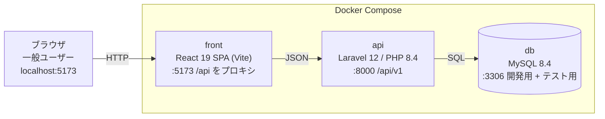
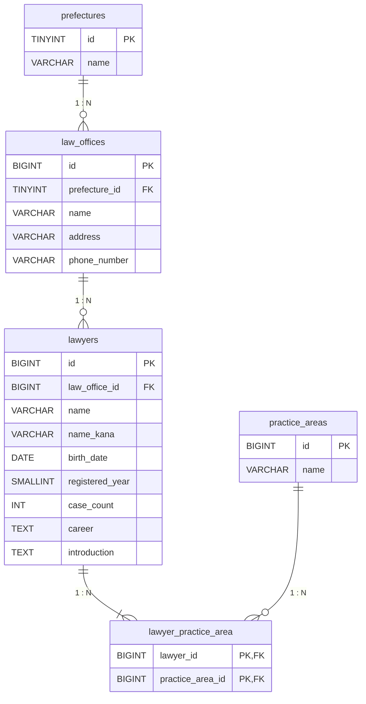

# 弁護士検索システム 要件定義書

2026-11-14

## 1. 概要

一般ユーザーが都道府県・取扱分野・キーワードで弁護士を検索し、一覧のソートと詳細の閲覧ができるSPAを、2日間で個人開発する。ポートフォリオとして、API設計、DB設計、テストの品質を示すことを目的とする。

| 項目 | 内容 |
| --- | --- |
| 開発目的 | ポートフォリオ(学習作品) |
| 利用者 | 一般ユーザーのみ(ログイン不要) |
| 開発体制 | 個人開発 |
| 開発期間 | 2日間 |
| 構成 | Laravel 12(REST API)+ React 19(SPA)+ MySQL 8.4 |
| 起動方法 | `docker compose up -d` で db / api / front の3コンテナを一括起動 |

### システム構成図



ブラウザはfrontにだけ接続し、`/api` へのリクエストはViteのプロキシ経由でapiに届く。

## 2. スコープ

MVPは「検索 → 一覧(ソート・ページネーション)→ 詳細」の閲覧機能に絞り、データの更新機能は持たない。

| 区分 | 項目 |
| --- | --- |
| 対象 | 都道府県・取扱分野(複数選択・OR)・キーワードによる検索 |
| 対象 | 名前・年齢・取扱裁判実績数によるソート |
| 対象 | 1ページあたり20件のページネーション |
| 対象 | 弁護士の詳細ページ |
| 対象 | Seederによるダミーデータ1,000件の投入 |
| 対象 | PHPUnitによる正常系・異常系のテスト |
| 対象 | docker-composeによるローカル開発環境 |
| 対象外 | 会員登録・ログインなどの認証機能 |
| 対象外 | 管理画面、弁護士本人による登録・編集 |
| 対象外 | 顔写真・画像のアップロード |
| 対象外 | お気に入り、問い合わせ、口コミ、地図表示 |
| 対象外 | 市区町村・最寄り駅など、都道府県より細かい地域検索 |
| 対象外 | 本番環境(AWSなど)へのデプロイ |
| 対象外 | フロントエンドの自動テスト |

## 3. 機能要件

検索条件は3種類で、条件同士はAND、取扱分野の複数選択だけはORで結合する。一覧は取扱裁判実績数の多い順を初期表示とする。

### 3.1 検索

| ID | 機能 | 仕様 |
| --- | --- | --- |
| F-01 | 都道府県で絞り込む | 47都道府県から1つ選ぶ(単一選択)。未選択なら全国が対象。弁護士の都道府県は所属事務所の所在地で判定する |
| F-02 | 取扱分野で絞り込む | 複数選択できる。選んだ分野のいずれか1つでも扱う弁護士を返す(OR条件)。結果に同じ弁護士を重複させない |
| F-03 | キーワードで検索する | 名前・フリガナ・事務所名・自己紹介を部分一致で検索する。空白(半角・全角)で区切った複数語はAND。最大100文字 |
| F-04 | 条件を組み合わせる | F-01〜F-03はANDで結合する。全条件が未入力なら全件を返す |
| F-05 | 検索条件をURLに保持する | 条件・ソート・ページをクエリ文字列に持ち、リロードやブラウザバックでも同じ結果を表示する |
| F-06 | 条件をクリアする | クリアボタンで全条件を初期化し、全件を表示する |

### 3.2 一覧・ソート・ページネーション

| ID | 機能 | 仕様 |
| --- | --- | --- |
| F-07 | 検索結果を一覧表示する | 名前、年齢、事務所名、都道府県、取扱分野(タグ)、取扱裁判実績数をカードで表示する。総件数も表示する |
| F-08 | 取扱裁判実績数でソートする | 全分野合計の実績数が多い順。初期表示のソート |
| F-09 | 年齢でソートする | 年齢が高い順(生年月日の古い順)。日単位で並べる |
| F-10 | 名前でソートする | フリガナの五十音順(あ→ん) |
| F-11 | 並び順を安定させる | ソートキーが同じ値のときはIDの昇順で並べ、ページをまたいで重複や欠落が起きないようにする |
| F-12 | ページを切り替える | 1ページあたり20件。ページ番号と前後ボタンで切り替える。条件やソートを変えたら1ページ目に戻す |
| F-13 | 0件時の表示 | 「条件に一致する弁護士が見つかりませんでした」と表示する |

### 3.3 詳細

| ID | 機能 | 仕様 |
| --- | --- | --- |
| F-14 | 弁護士の詳細を表示する | 名前、フリガナ、年齢(生年月日から算出)、弁護士登録年、所属事務所、事務所住所、電話番号、取扱分野、取扱裁判実績数、経歴、自己紹介 |
| F-15 | 一覧へ戻る | 「検索結果に戻る」で、直前の検索条件・ソート・ページを復元する |
| F-16 | 存在しないIDへの対応 | 404画面を表示する |

### 3.4 共通

| ID | 機能 | 仕様 |
| --- | --- | --- |
| F-17 | 読み込み中の表示 | API通信中はスケルトンまたはスピナーを表示する |
| F-18 | エラーの表示 | 入力エラー(422)は項目の近くに、サーバーエラー(500)や通信エラーは画面上部に表示する |
| F-19 | マスターの取得 | 都道府県と取扱分野の選択肢はAPIから取得する(フロントにハードコードしない) |

取扱分野の初期マスターは12分野とする:離婚・男女問題、相続、交通事故、債務整理、刑事事件、労働問題、企業法務、不動産・建築、医療問題、消費者被害、知的財産、外国人問題。

## 4. 画面一覧

画面は検索・一覧、詳細、404の3つ。検索フォームと結果一覧は1画面にまとめ、画面遷移を減らす。

| ID | 画面名 | URL | 概要 | 使用API | 関連機能 |
| --- | --- | --- | --- | --- | --- |
| SCR-01 | 弁護士検索・一覧 | `/`(例:`/?prefecture_id=13&practice_area_ids[]=1&keyword=山田&sort=age&page=2`) | 上部に検索フォーム、下部に総件数・ソート切替・結果カード20件・ページャー | API-01, API-03, API-04 | F-01〜F-13, F-17〜F-19 |
| SCR-02 | 弁護士詳細 | `/lawyers/:id` | 弁護士の全項目と「検索結果に戻る」リンク | API-02 | F-14〜F-18 |
| SCR-03 | ページが見つかりません | `*`(上記以外のURL、存在しない弁護士ID) | メッセージと検索画面へのリンク | なし | F-16 |

### 4.1 SCR-01 の構成要素

| エリア | 要素 | 入力・表示形式 |
| --- | --- | --- |
| 検索フォーム | 都道府県 | セレクトボックス(先頭は「すべて」) |
| 検索フォーム | 取扱分野 | チェックボックス(12個、複数選択) |
| 検索フォーム | キーワード | テキスト入力(プレースホルダー:名前・事務所名・自己紹介) |
| 検索フォーム | 検索 / クリア | ボタン |
| 結果ヘッダー | 総件数 | 「○○件中 1〜20件を表示」 |
| 結果ヘッダー | ソート | セレクトボックス(実績数が多い順 / 年齢が高い順 / 名前順) |
| 結果一覧 | 弁護士カード | 名前、年齢、事務所名、都道府県、取扱分野タグ、実績数。クリックでSCR-02へ |
| ページャー | ページ番号 | 前へ / ページ番号 / 次へ |

レイアウトはPCとスマートフォンの両方に対応する(レスポンシブ)。

## 5. API一覧

APIは参照系の4本で、すべて認証不要のGETとする。ベースURLは `http://localhost:8000/api/v1`、形式はJSON(UTF-8)。

| ID | メソッド | パス | 概要 | 正常 | 異常 |
| --- | --- | --- | --- | --- | --- |
| API-01 | GET | `/lawyers` | 弁護士を検索し、ページ単位で返す | 200 | 422, 500 |
| API-02 | GET | `/lawyers/{id}` | 弁護士1件の詳細を返す | 200 | 404, 500 |
| API-03 | GET | `/prefectures` | 都道府県47件を返す | 200 | 500 |
| API-04 | GET | `/practice-areas` | 取扱分野の一覧を返す | 200 | 500 |

### 5.1 API-01 のリクエストパラメータ

| パラメータ | 型 | 必須 | バリデーション | 初期値 |
| --- | --- | --- | --- | --- |
| `prefecture_id` | integer | 任意 | `integer`, `exists:prefectures,id` | なし(全国) |
| `practice_area_ids[]` | integerの配列 | 任意 | `array`, `max:12`。要素は `integer`, `distinct`, `exists:practice_areas,id` | なし |
| `keyword` | string | 任意 | `string`, `max:100` | なし |
| `sort` | string | 任意 | `in:case_count,age,name` | `case_count` |
| `page` | integer | 任意 | `integer`, `min:1` | 1 |

バリデーションはFormRequest(`SearchLawyerRequest`)で行う。最終ページを超える `page` はエラーにせず、空の `data` を200で返す。

| `sort` | 並び順(SQL) |
| --- | --- |
| `case_count` | `case_count DESC, id ASC` |
| `age` | `birth_date ASC, id ASC` |
| `name` | `name_kana ASC, id ASC` |

### 5.2 API-01 のレスポンス(200)

```json
{
  "data": [
    {
      "id": 128,
      "name": "山田 太郎",
      "name_kana": "ヤマダ タロウ",
      "age": 52,
      "case_count": 340,
      "law_office": { "id": 12, "name": "山田総合法律事務所" },
      "prefecture": { "id": 13, "name": "東京都" },
      "practice_areas": [
        { "id": 1, "name": "離婚・男女問題" },
        { "id": 2, "name": "相続" }
      ]
    }
  ],
  "links": { "first": "...?page=1", "last": "...?page=50", "prev": null, "next": "...?page=2" },
  "meta": { "current_page": 1, "last_page": 50, "per_page": 20, "total": 1000, "from": 1, "to": 20 }
}
```

### 5.3 API-02 のレスポンス(200)

```json
{
  "data": {
    "id": 128,
    "name": "山田 太郎",
    "name_kana": "ヤマダ タロウ",
    "birth_date": "1974-04-12",
    "age": 52,
    "registered_year": 2001,
    "case_count": 340,
    "career": "2001年 弁護士登録 ...",
    "introduction": "相続と離婚を中心に ...",
    "law_office": {
      "id": 12,
      "name": "山田総合法律事務所",
      "address": "東京都千代田区 ...",
      "phone_number": "03-1234-5678"
    },
    "prefecture": { "id": 13, "name": "東京都" },
    "practice_areas": [ { "id": 1, "name": "離婚・男女問題" } ]
  }
}
```

API-03とAPI-04は `{ "data": [ { "id": 1, "name": "北海道" } ] }` の形で、`id` の昇順に返す。

### 5.4 エラーレスポンス

| ステータス | 発生条件 | ボディ |
| --- | --- | --- |
| 404 | 存在しないID、数値でないID、未定義のパス | `{ "message": "弁護士が見つかりません。" }` |
| 422 | バリデーションエラー | `{ "message": "...", "errors": { "keyword": ["キーワードは100文字以内で入力してください。"] } }` |
| 429 | レート制限超過(1IPあたり毎分60回) | `{ "message": "Too Many Attempts." }` |
| 500 | 予期しない例外 | `{ "message": "サーバーエラーが発生しました。" }`(スタックトレースは返さない) |

エラーメッセージは日本語とし、`lang/ja/validation.php` を用意する。

## 6. ER図・テーブル定義

テーブルは5つ。事務所を弁護士から切り出して正規化し、弁護士と取扱分野の多対多は中間テーブルで表す。弁護士の都道府県は事務所経由で決まる。



弁護士と取扱分野の多対多は、lawyer_practice_area で2つの1対Nに分解している。created_at / updated_at は図では省略した。

### 6.1 prefectures(都道府県マスター)

| カラム | 型 | NULL | キー | 説明 |
| --- | --- | --- | --- | --- |
| id | TINYINT UNSIGNED | 不可 | PK | JISの都道府県コード(1〜47) |
| name | VARCHAR(10) | 不可 | UNIQUE | 都道府県名 |
| created_at / updated_at | TIMESTAMP | 可 | | |

### 6.2 practice_areas(取扱分野マスター)

| カラム | 型 | NULL | キー | 説明 |
| --- | --- | --- | --- | --- |
| id | BIGINT UNSIGNED | 不可 | PK | |
| name | VARCHAR(50) | 不可 | UNIQUE | 分野名 |
| created_at / updated_at | TIMESTAMP | 可 | | |

### 6.3 law_offices(法律事務所)

| カラム | 型 | NULL | キー | 説明 |
| --- | --- | --- | --- | --- |
| id | BIGINT UNSIGNED | 不可 | PK | |
| prefecture_id | TINYINT UNSIGNED | 不可 | FK, INDEX | prefectures.id |
| name | VARCHAR(100) | 不可 | | 事務所名(キーワード検索の対象) |
| address | VARCHAR(255) | 不可 | | 住所(都道府県から) |
| phone_number | VARCHAR(20) | 不可 | | ハイフン付き |
| created_at / updated_at | TIMESTAMP | 可 | | |

### 6.4 lawyers(弁護士)

| カラム | 型 | NULL | キー | 説明 |
| --- | --- | --- | --- | --- |
| id | BIGINT UNSIGNED | 不可 | PK | |
| law_office_id | BIGINT UNSIGNED | 不可 | FK, INDEX | law_offices.id |
| name | VARCHAR(50) | 不可 | | 氏名(姓と名の間に半角スペース) |
| name_kana | VARCHAR(100) | 不可 | INDEX | フリガナ(全角カタカナ)。名前順ソートに使う |
| birth_date | DATE | 不可 | INDEX | 生年月日。年齢は保存せず、取得時に算出する |
| registered_year | SMALLINT UNSIGNED | 不可 | | 弁護士登録年 |
| case_count | INT UNSIGNED | 不可 | INDEX | 取扱裁判実績数(全分野の合計)。初期値0 |
| career | TEXT | 不可 | | 経歴 |
| introduction | TEXT | 不可 | | 自己紹介(キーワード検索の対象) |
| created_at / updated_at | TIMESTAMP | 可 | | |

### 6.5 lawyer_practice_area(弁護士×取扱分野の中間テーブル)

| カラム | 型 | NULL | キー | 説明 |
| --- | --- | --- | --- | --- |
| lawyer_id | BIGINT UNSIGNED | 不可 | PK(1番目), FK | lawyers.id(弁護士削除時に CASCADE) |
| practice_area_id | BIGINT UNSIGNED | 不可 | PK(2番目), FK, INDEX | practice_areas.id |

複合主キー (lawyer_id, practice_area_id) で重複登録を防ぐ。分野での絞り込み用に (practice_area_id, lawyer_id) のインデックスを別に張る。

### 6.6 検索クエリの方針

- 分野のOR条件はJOINではなく `whereHas(... whereIn('practice_area_id', $ids))`(EXISTSサブクエリ)で書き、結果の重複を防ぐ
- 一覧の関連データは `with(['lawOffice.prefecture', 'practiceAreas'])` で事前に読み込み、N+1問題を防ぐ
- キーワードの `LIKE '%語%'` はインデックスが効かない。ただし1,000件では問題にならないため採用し、件数が増えたときはFULLTEXTインデックス(ngram)への切替を検討する
- `LIKE` に渡す前に `%` と `_` をエスケープする

### 6.7 ダミーデータ(Seeder)

| テーブル | 件数 | 生成ルール |
| --- | --- | --- |
| prefectures | 47 | 固定値 |
| practice_areas | 12 | 固定値(3.4節の12分野) |
| law_offices | 300 | Faker(ja_JP)。都道府県は人口に応じて偏らせ、東京・大阪・愛知などを多くする |
| lawyers | 1,000 | 25〜80歳。登録年は25歳以降の年。実績数は0〜500 |
| lawyer_practice_area | 約2,500 | 1人あたり1〜4分野をランダムに割り当てる |

Fakerのシード値を固定し、何度投入しても同じデータになるようにする。実行は `php artisan migrate:fresh --seed`。

## 7. 非機能要件

ローカル環境での動作を前提に、性能・セキュリティ・保守性の目標を定める。

### 7.1 技術スタック

| 区分 | 採用技術 | バージョン |
| --- | --- | --- |
| バックエンド | PHP / Laravel | 8.4 / 12 |
| フロントエンド | React + TypeScript(Vite) | 19 / 5系 |
| ルーティング | React Router | 7 |
| データ取得 | TanStack Query + axios | 5 / 1系 |
| CSS | Tailwind CSS | 4 |
| DB | MySQL(utf8mb4 / utf8mb4_0900_ai_ci) | 8.4 |
| テスト | PHPUnit | 11 |
| コード整形 | Laravel Pint(PHP)、ESLint + Prettier(TS) | 最新 |
| コンテナ | Docker / Docker Compose v2 | 最新 |

### 7.2 コンテナ構成

| サービス | イメージ | ポート | 役割 |
| --- | --- | --- | --- |
| db | mysql:8.4 | 3306 | 開発用DB `lawyer_search` とテスト用DB `lawyer_search_test` を持つ。データは名前付きボリュームで永続化 |
| api | php:8.4(Dockerfileで拡張を追加) | 8000 | Laravel。`php artisan serve` で起動。dbのヘルスチェック通過後に起動する |
| front | node:22 | 5173 | Viteの開発サーバー。`/api` へのリクエストは api コンテナへプロキシする |

`docker compose up -d` のあと `docker compose exec api php artisan migrate:fresh --seed` を実行すれば、`http://localhost:5173` で画面を開ける状態にする。手順はREADMEに書く。

### 7.3 性能

| 項目 | 目標値 |
| --- | --- |
| API-01(検索)の応答時間 | 1,000件・全条件指定で500ms以内 |
| API-02〜04の応答時間 | 200ms以内 |
| 1リクエストあたりのSQL発行数 | 件数によらず一定(N+1を出さない) |
| 初回画面表示 | 2秒以内 |

### 7.4 セキュリティ

- SQLインジェクション:Eloquent / クエリビルダーのバインドのみ使い、生SQLに入力値を連結しない
- XSS:Reactの自動エスケープに任せ、`dangerouslySetInnerHTML` は使わない
- CORS:許可するオリジンは `http://localhost:5173` のみ
- レート制限:API全体に1IPあたり毎分60回(Laravelの `throttle:api`)
- 入力検証:すべてのパラメータをFormRequestで検証する
- 情報漏えい:`APP_DEBUG=false` のとき、500エラーでスタックトレースを返さない。`.env` はリポジトリに含めず `.env.example` を置く

### 7.5 保守性

- バックエンドの責務を分ける:Controller(入出力のみ)→ FormRequest(検証)→ Service(検索ロジック)→ Model(スコープ・アクセサ)→ API Resource(整形)
- ソート種別はPHPのEnum(`LawyerSortType`)で定義し、文字列を直書きしない
- フロントは画面(pages)・部品(components)・API呼び出し(api)・型定義(types)に分け、TypeScriptは `strict` を有効にする
- PHPはすべてのファイルに `declare(strict_types=1);` と引数・戻り値の型を書く

### 7.6 対応環境

| 項目 | 内容 |
| --- | --- |
| ブラウザ | Chrome / Edge / Safari / Firefox の最新版 |
| 画面幅 | スマートフォン(375px〜)とPC(1280px〜) |
| 可用性・バックアップ | ローカル開発のみのため定めない。データはSeederで再生成できる |
| ログ | Laravel標準の `storage/logs`。500エラー時は例外を記録する |

## 8. テスト方針

バックエンドのすべてのpublicメソッドとAPIについて、正常系と異常系をPHPUnitでテストする。合格基準は「全テスト成功」と「`app/` の行カバレッジ80%以上」。

### 8.1 実施方法

| 項目 | 内容 |
| --- | --- |
| ツール | PHPUnit 11(`php artisan test`) |
| テスト用DB | dbコンテナ内のMySQL `lawyer_search_test`(本番と同じMySQLで確認するためSQLiteは使わない) |
| データの初期化 | `RefreshDatabase` でテストごとにロールバックする |
| テストデータ | Factoryでテストごとに必要な件数だけ作る(Seederの1,000件には依存しない) |
| 日付 | 年齢のテストは `$this->travelTo()` で現在日時を固定する |
| 実行コマンド | `docker compose exec api php artisan test --coverage` |
| テスト名 | `test_対象_条件_期待結果` の形で書く(例:`test_search_存在しない都道府県ID_422を返す`) |

### 8.2 Featureテスト(API単位)

| 対象 | 区分 | テストケース | 期待結果 |
| --- | --- | --- | --- |
| API-01 | 正常 | 条件なしで検索する | 200。`data` が20件、`meta.total` が全件数 |
| API-01 | 正常 | 都道府県を指定する | その県の事務所に所属する弁護士だけを返す |
| API-01 | 正常 | 分野を2つ指定する | どちらかを扱う弁護士を返し、両方を扱う弁護士が重複しない |
| API-01 | 正常 | キーワードで検索する | 名前・フリガナ・事務所名・自己紹介のどれかに含む弁護士をそれぞれ返す |
| API-01 | 正常 | 空白区切りの2語で検索する | 両方を含む弁護士だけを返す |
| API-01 | 正常 | 3条件をすべて指定する | すべてを満たす弁護士だけを返す(AND) |
| API-01 | 正常 | `sort` を省略 / `case_count` / `age` / `name` | それぞれ5.1節の順に並ぶ。同値はID昇順 |
| API-01 | 正常 | 2ページ目を指定する | 21件目から返し、1ページ目と重複しない |
| API-01 | 正常 | 最終ページを超えるページを指定する | 200。`data` が空 |
| API-01 | 正常 | 該当が0件の条件 | 200。`data` が空、`meta.total` が0 |
| API-01 | 正常 | `%` を含むキーワード | ワイルドカードとして扱わず、文字として検索する |
| API-01 | 異常 | 存在しない `prefecture_id`(48)、数値でない値 | 422。`errors.prefecture_id` がある |
| API-01 | 異常 | `practice_area_ids` が配列でない、存在しないID、重複ID | 422 |
| API-01 | 異常 | `keyword` が101文字 | 422(100文字は200) |
| API-01 | 異常 | `sort` が定義外(`price`) | 422 |
| API-01 | 異常 | `page` が0、負数、文字列 | 422 |
| API-02 | 正常 | 存在するID | 200。5.3節の全項目を返す |
| API-02 | 異常 | 存在しないID、数値でないID | 404。日本語の `message` を返す |
| API-03 | 正常 | 一覧を取得する | 200。47件をID昇順で返す |
| API-04 | 正常 | 一覧を取得する | 200。登録件数分をID昇順で返す |
| API-03, 04 | 異常 | マスターが0件 | 200。空配列を返す |
| 共通 | 異常 | 未定義のパス | 404 |
| 共通 | 異常 | 1分間に61回リクエストする | 61回目が429 |

### 8.3 Unitテスト(メソッド単位)

| 対象メソッド | 区分 | テストケース |
| --- | --- | --- |
| `Lawyer::age`(アクセサ) | 正常 | 誕生日の前日・当日・翌日で年齢が正しく切り替わる |
| `Lawyer::age` | 正常 | 2月29日生まれをうるう年以外で計算できる |
| `LawyerSearchService::search` | 正常 | 各条件を単独・組み合わせで渡し、正しい件数を返す |
| `LawyerSearchService::search` | 異常 | 空文字・空白のみのキーワード、空配列の分野は「条件なし」として扱う |
| `Lawyer` の各スコープ(`inPrefecture` / `withAnyPracticeArea` / `matchKeyword`) | 正常 | 対象だけを絞り込む |
| 各スコープ | 異常 | `null` を渡すと絞り込みを行わない |
| `LawyerSortType::orderColumns` | 正常 | 3種類それぞれの並び順を返す |
| `LawyerSortType::tryFrom` | 異常 | 定義外の文字列で `null` を返す |
| `escapeLike`(LIKE用エスケープ) | 正常・異常 | `%`、`_`、`\` をエスケープし、通常の文字はそのまま返す |
| Seeder | 正常 | 実行後に都道府県47件、分野12件、弁護士1,000件があり、全員が1分野以上を持つ |

メソッドを追加したら、同じコミットで正常系と異常系のテストを追加する。

## 9. 開発スケジュールと前提事項

1日目でAPIとテストを、2日目で画面を仕上げる。APIを先に固めることで、フロントは実データで作れる。

| 時期 | 作業 | 完了条件 |
| --- | --- | --- |
| 1日目 午前 | docker-composeとLaravel/Reactの初期構築、マイグレーション、Factory、Seeder | `docker compose up -d` と `migrate:fresh --seed` で1,000件が入る |
| 1日目 午後 | API-01〜04の実装、Feature・Unitテスト | 8章のテストがすべて成功する |
| 2日目 午前 | SCR-01(検索・一覧・ソート・ページャー)とURLの条件保持 | ブラウザで検索からページ切替まで動く |
| 2日目 午後 | SCR-02・SCR-03、エラー表示、レスポンシブ対応、README | READMEの手順だけで別の環境でも起動できる |

### 9.1 ヒアリングで決まっていない点(仮置き)

以下は仮に決めて書いている。違う場合は修正する。

- [ ] 都道府県は1つだけ選べる(単一選択)とした。複数選択にするか
- [ ] 「ソートは大きい方から」を、実績数は多い順、年齢は高い順とした。名前は「大きい」が定義しにくいため、五十音順(あ→ん)とした。昇順・降順を切り替えられるようにするか
- [ ] キーワードの検索対象にフリガナを足した。空白で区切った複数語はANDとした
- [ ] デプロイについて回答がなかったため、ローカルのdocker-composeで完結するものとした
- [ ] 「20県ごと」は「20件ごと」と解釈した
- [ ] 事務所を別テーブルに切り出した(複数の弁護士が同じ事務所に所属できる)。事務所の電話番号を弁護士の連絡先として表示する